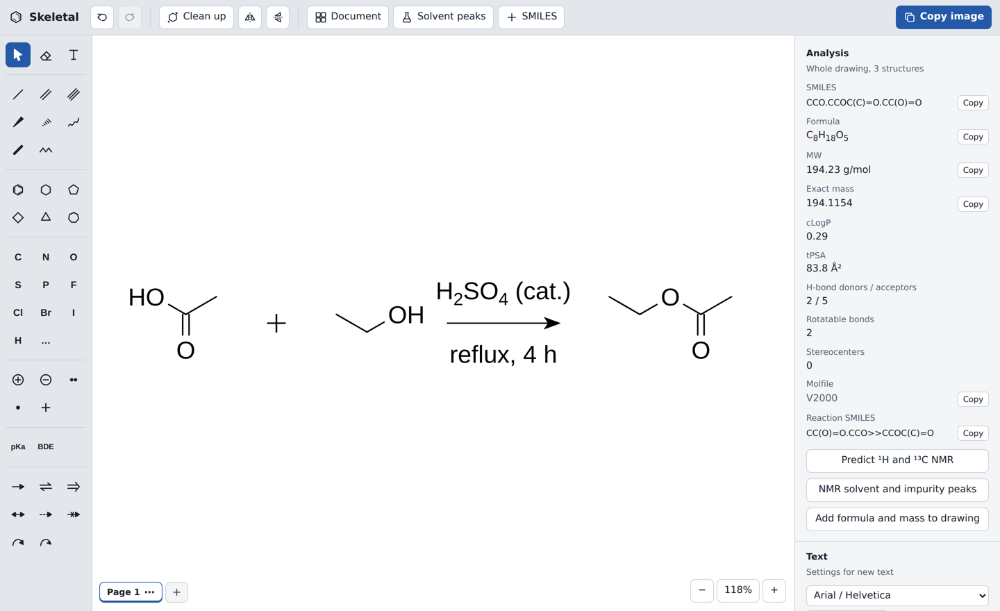
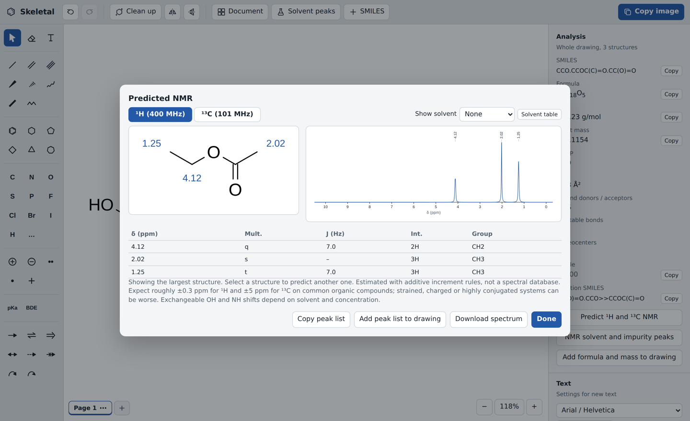

# Lone Pair

A chemical structure editor that runs entirely in the browser. Draw molecules, reactions and arrow-pushing mechanisms in ACS journal style, then copy them into PowerPoint or Word or export them as PNG, SVG or PDF. Built-in tools estimate ¹H/¹³C NMR spectra, pKa values and bond dissociation energies, and look up NMR solvent and impurity peaks.

The whole app is one HTML file (about 2.4 MB). It needs no server, no install and no account, and works offline. The only exceptions are the name/CAS lookup and the database search, which you start yourself.



## Quick start

1. Use it at [lonepair.app](https://lonepair.app/), or download [`dist/lonepair.html`](dist/lonepair.html) and open it.
2. Open it in Chrome, Edge, Firefox or Safari.

That's it. Your work autosaves in the browser. Use **Save project (.html)** to keep a copy you can reopen anywhere.

To host it, see [Hosting on Cloudflare Pages](#hosting-on-cloudflare-pages), or publish `dist/lonepair.html` on any static file server.

## Features

### Drawing
- Single, double, triple, wedge, hashed, wavy and bold bonds, plus a chain tool with a live atom count.
- Benzene and 3- to 7-membered rings. Click a bond to fuse a ring, or click an atom to make a spiro ring.
- Any element, nicknames (OMe, Boc, Ph, CO₂H, Ts and about 50 more) and generic labels (R, R¹, X).
- Nicknames count toward formula and mass, and flip automatically (MeO, HO₂C) when the bond comes from the right.
- Charges, lone pairs and radicals.
- Reaction, equilibrium, retrosynthetic, resonance, dashed and failed-reaction arrows.
- Curved electron-pushing arrows (full and fishhook) with a draggable bend handle.
- Text with automatic chemical subscripts (H2SO4 → H₂SO₄) and `^` superscripts (Fe^3+). Each text box can have its own font, size, bold, italic, alignment and color.
- **Clean up** redraws the geometry while keeping stereochemistry. Flip, rotate, undo and redo are available throughout.
- **Align** lines up structures, arrows and plus signs by their left, center, right, top, middle or bottom edges, or spaces them evenly across or down. **Scheme row** does both in one click: it puts every piece of a reaction on one centerline with equal gaps. Compound numbers and reagent text move with the structure or arrow they belong to. An optional **Gap** sets a fixed spacing in bond lengths, so schemes across a paper match.
- Insert structures from SMILES, reaction SMILES (`A.B>>C`), InChI or molfiles, or start from 16 built-in templates. You can also type a compound name or CAS number, which is looked up on PubChem. ChemDraw (.cdxml, .cdx), CML and Marvin (.mrv) files open directly, or by drag and drop.
- **Lasso** (L): select by drawing a freehand loop. V switches back to the box.
- **Enhanced stereochemistry:** right-click a stereocenter to label it abs, &1 (racemic) or or1 (relative), as in ChemDraw. The labels are saved in V3000 molfiles and ChemDraw files.
- **TLC plates:** draw lanes, spots and streaks with Rf values and the eluent. They're drawn in the page style and can be edited by double-clicking.
- **Groups** (Ctrl+G): a structure and its label select, move and align as one.
- **Smart guides**: while you drag, the selection snaps to the centers and edges of other structures. Hold Alt to drag freely.
- Right-click a structure to copy its SMILES or molfile, or to look up its name and CAS number.

### Publication output
- **Journal styles:**
  - **ACS Document 1996:** 14.4 pt bonds, 0.6 pt lines, 2.0 pt bold bonds, 18% bond spacing, Arial 10 pt labels.
  - **RSC:** values from ChemDraw 22's RSC 1-column style sheet: 12.2 pt bonds, 0.45 pt lines, 7 pt labels.
  - **Nature Reviews:** values from its structure style guide: 0.381 cm bonds, 0.021 cm lines, 6 pt Arial labels.
  - **Slides.**
  - Switching styles rescales the drawing so every bond takes the new length.
- **Drawing settings**, as in ChemDraw: bond length, line width, bold width, wedge width, bond spacing, hash spacing and margin width. Set them for one page, or apply them to all pages.
- **Copy image** puts a high-resolution transparent PNG on the clipboard for Office.
- **Download PNG** saves a 600 dpi file with the dpi recorded, so it inserts at true size.
- **Download SVG** gives vector graphics; PowerPoint can convert them to shapes.
- **Vector PDF** export with standard fonts: cropped to the drawing, the whole document, or tiled printable sheets.
- **Save as…** (Ctrl+Shift+S) lists every format in one place:

  | Kind | Formats |
  | --- | --- |
  | Images | PNG, JPEG, WebP, GIF, SVG, PDF, EPS |
  | ChemDraw | CDXML and CDX, both writing and opening. These keep the document style, labels, nicknames, stereo bonds, arrows, text and colors |
  | Structure files | Molfile V2000 and V3000, SD file, RXN V2000 and V3000, SMILES, SMARTS, InChI, InChIKey, CML (writing and opening), Marvin MRV (writing and opening), JME, chemfig (LaTeX) |
  | 3D | XYZ, PDB, 3D SD file, from a generated conformer |

  InChI and InChIKey come from the official IUPAC InChI library, bundled as WebAssembly, so they work offline. Retired formats from ChemDraw's list (ISIS Sketch and TGF, SMD, PICT, MIF, SWF, WMF, Sybyl SLN) are not written; SVG, PDF and EPS cover their uses.
- **Document size:**
  - Letter, A4, Legal, Tabloid, A3, ACS single column (3.33 in), ACS double column (7 in), 16:9 and 4:3 slides, or a custom size.
  - Portrait or landscape.
  - Up to 8 × 8 sheets for posters.

### Projects
- Multiple pages per project, shown as tabs.
- Named versions stored inside the project, with one-click restore. Restoring first saves your current state as another version.
- **Save project (.html)** (Ctrl/⌘ + S) writes a complete copy of the editor with your pages and versions inside it. Double-click the file to keep working, or open it again on the website.
  - **Chrome and Edge:** Lone Pair remembers the file you saved or opened, and Ctrl/⌘ + S writes back into it. The tab title shows • while there are unsaved changes, and **Save as new file** makes a copy.
  - **Firefox and Safari:** saving downloads a new copy each time.
- Exported PNGs and SVGs carry the drawing data, so you can open them in Lone Pair and edit them again.

### Chemistry tools
- **Analysis block:** pick any of chemical formula, exact mass, molecular weight, m/z (isotope peaks), elemental analysis, cLogP, LogS and tPSA, as in ChemDraw's Analysis window. Copy the block, or add it under the structure. It also writes the journal line "Anal. Calcd for C9H8O4: C, 60.00; H, 4.48."
- **NMR solving guide:** a tutorial for working out a structure from its spectra.
  - **Workflow:** a 10-step procedure from formula to checked structure.
  - **Calculators:** degree of unsaturation, Rule of 13 candidate formulas (with the nitrogen rule), and scaling integrals to H counts.
  - **Shift charts:** ¹H and ¹³C charts with source-tagged tables, notes on exchangeable protons, and solvent peaks.
  - **Splitting:** n+1 multiplets with Pascal intensities, second-order effects and typical J values.
  - **Benzene patterns:** substitution patterns, including AA′BB′ for para rings, and a ring-proton shift predictor based on Reich's increments.
  - **Methods:** DEPT, APT, COSY, TOCSY, HSQC, HMBC and NOESY.
  - **Worked examples:** three, using published data.
  - **Sources:** values come from Reich's NMR collection, the UW-Madison tables, Fulmer et al. 2010 and Bright & Chen 1983. Where sources disagree, the guide shows a soft range.
- **Mass spectrum:**
  - Monoisotopic mass, plus the m/z of common adducts: [M+H]⁺, [M+Na]⁺, [M+K]⁺, [M+NH₄]⁺, [M+2H]²⁺, M⁺•, [M−H]⁻, [M+Cl]⁻ and [M+HCOO]⁻.
  - A journal-style HRMS line you can copy.
  - The isotope pattern, as a plot and a table.
  - A **predicted MS/MS** spectrum for [M+H]⁺ or [M−H]⁻ at three collision energies. It is rule-based: bond cleavages, ring openings and common neutral losses. Clicking a peak shows which atoms the fragment ion keeps and which bonds break.
  - The Analysis panel also shows m/z for [M+H]⁺.
- **3D view:** a conformer from OpenChemLib, refined with MMFF94s, in ball-and-stick, space-filling or stick style. You can rotate and zoom it, and export it as XYZ, PDB, 3D SDF or PNG. It works offline.
- **Find in databases:** sends the structure to PubChem (exact, similarity, substructure or superstructure search), RCSB PDB ligands, ChEMBL, or Google and Google Scholar by InChIKey.
- **Name and CAS lookup:** finds the name, IUPAC name, CAS Registry Number, InChIKey and PubChem record for the selected structure, with links to verify the CAS number on CAS Common Chemistry or search the web. This is the only feature that uses the internet. It sends only the structure's SMILES to PubChem, and only when you click it.
- **Analysis panel:** SMILES, InChI, InChIKey, formula, MW, exact mass, cLogP, tPSA, H-bond donors and acceptors, rotatable bonds, stereocenters and molfile, plus reaction SMILES built from the drawn arrow.
- **NMR prediction:**
  - ¹H and ¹³C shifts written on the structure, a simulated spectrum and a peak table with multiplicity, J and integration.
  - An optional overlay of solvent residual and water peaks.
  - A journal-format peak list you can copy or add to the drawing.
- **pKa tool:** click an atom to get the pKa of its hydrogen in water and DMSO, or the pKaH if the atom is a base.
- **BDE tool:** click a bond for its homolytic bond dissociation energy, or click an atom for its X–H bond.
- **Solvent peaks reference:**
  - Residual ¹H and ¹³C peaks and water/HDO peaks for 10 deuterated solvents.
  - About 40 common impurities in each solvent.
  - Search by name or by shift, for example typing 2.17 finds acetone in CDCl₃.



## Keyboard and mouse

| Action | How |
| --- | --- |
| Change the atom under the cursor | Hover and press C, N, O, S, P, F, L (Cl), B (Br), I or H |
| Charge the atom under the cursor | Hover and press + or − |
| Set the order of the bond under the cursor | Hover and press 1, 2 or 3 |
| Edit an atom label | Double-click it (press and hold on touch screens) |
| Select | Drag a box with the Select tool; Shift adds to the selection. Delete only removes what is selected. |
| Draw without angle snapping | Hold Alt while dragging |
| Pan and zoom | Space + drag, two fingers, or Ctrl + wheel |
| Copy image, paste, duplicate | Ctrl/⌘ + C, V, D |
| Save the project | Ctrl/⌘ + S. In Chrome and Edge this writes back to the file you saved or opened; other browsers download a copy |
| Open a project or file | Ctrl/⌘ + O, or **Open** in the header, or drag a file onto the canvas |
| Copy SMILES | Ctrl/⌘ + Shift + C, or right-click |
| Group, ungroup | Ctrl/⌘ + G, Ctrl/⌘ + Shift + G |
| Nudge the selection | Arrow keys (Shift: 5 pt) |
| Rotate the selection 15° | [ and ] |
| New line in text | Shift + Enter |

## How the estimates work, and how accurate they are

All predictions are rule-based. They run instantly and offline, but they are estimates, not measurements. Each result card in the app shows the reference value and correction it used.

| Tool | Method | Held-out error* |
| --- | --- | --- |
| ¹H NMR | Shoolery/Pretsch increments for sp³ C–H, Pretsch Z values for aromatic H, Pascual–Meier–Simon increments for alkene H, first-order multiplets | MAE 0.08 ppm, max 0.39 |
| ¹³C NMR | Grant–Paul and substituent increments, benzene ipso/ortho/meta/para increments, alkene and carbonyl class tables | MAE 0.7 ppm, max 6.3 |
| pKa | Class values from the Evans–Ripin, Bordwell/Reich (DMSO) and Williams (water) tables, Hammett σ for aromatic sites, inductive attenuation for aliphatic sites | MAE 0.4, 19 of 22 within 1 unit, max 2.7 |
| BDE | Blanksby & Ellison (2003) values plus additive radical-stabilization terms; Sanderson/Reusch R–X values for other bonds | Reference set within 1 kcal/mol; expect ±2–3 for other molecules |

\* "Held-out" means 10 NMR compounds and 22 pKa sites that were not used while tuning the rules. Run `npm run validate` to reproduce these numbers.

Known weak spots:
- Saturated rings: the γ-carbon of cyclohexanone is about 6 ppm off.
- C–H acidity with two different activating groups: deoxybenzoin is 2.7 units too acidic and ethyl acetoacetate 1.6 units too acidic.
- Ortho effects and zwitterions.
- OH and NH shifts, which depend on solvent.

For research decisions, confirm against measured data or a database-backed or machine-learning predictor.

## Development

Requirements: Node.js 20 or later. Python 3.10 or later is needed for the browser tests.

```bash
npm install          # OpenChemLib + esbuild
npm run build        # writes dist/lonepair.html
npm test             # 128 unit tests (Node test runner)
npm run validate     # held-out accuracy report for NMR and pKa
pip install -r requirements-dev.txt && python -m playwright install chromium
npm run test:e2e     # 73 browser tests (Playwright; the 3 sign-in tests need Node 22 for wrangler and a built site/)
```

To cross-check the chemical file formats with RDKit and Open Babel (`pip install rdkit openbabel-wheel`):

```bash
node scripts/gen_format_samples.mjs out && python scripts/check_formats.py out
```

### Project layout

```
src/
  shell.html     page markup and CSS; the build fills in the /*OCL*/ and /*APP*/ markers
  core.js        data model, geometry, label layout, SVG rendering, OpenChemLib bridge, file sanitizer
  nmr.js         NMR, pKa and BDE estimators
  pdf.js         vector PDF and EPS writer for the app's own SVG
  solvents.js    NMR solvent and impurity data (Fulmer et al. 2010)
  formats.js     ChemDraw CDXML/CDX, CML, MRV, JME, chemfig, SDF and RXN writers and readers
  ms.js          exact masses, adducts, isotope patterns, MS/MS fragment estimate
  view3d.js      3D conformer view and XYZ/PDB export
  app.js         interaction, tools, pages and versions, export, dialogs
scripts/
  build.mjs      bundles OpenChemLib and InChI, embeds the 3D tables, inlines everything into one file
  validate.mjs   held-out accuracy check
  gen_format_samples.mjs, check_formats.py   format cross-check against RDKit and Open Babel
tests/unit/      chemistry, data and sanitizer tests (Node VM with DOM stubs)
tests/e2e/       Playwright tests against dist/lonepair.html
dist/            the built app (committed, so it can be downloaded directly)
```

The files are plain browser scripts that share one global scope and load in the order listed in `scripts/build.mjs`. Edit them in `src/`, then run `npm run build`.

### Drawing format

A drawing is JSON. Coordinates are in points, with y pointing down.

```json
{ "atoms":  [{ "id": 1, "x": 0, "y": 0, "el": "C", "charge": 0, "lp": 0, "rad": 0 }],
  "bonds":  [{ "id": 3, "a": 1, "b": 2, "order": 1, "stereo": "none|wedge|hash|wavy|bold" }],
  "arrows": [{ "id": 4, "type": "reaction|equilibrium|retro|resonance|dashed|nogo|curly|fishhook", "x1": 0, "y1": 0, "x2": 40, "y2": 0 }],
  "texts":  [{ "id": 5, "x": 0, "y": 20, "text": "H2SO4", "size": 10, "font": "sans|serif|mono" }],
  "pluses": [], "style": "acs|slides", "page": { "w": 612, "h": 792, "across": 1, "down": 1 } }
```

A project wraps a list of `pages` (each holding one drawing) and a list of `versions`. Every file is passed through `sanitizeDoc()` when it is loaded, because values end up in SVG markup.

## Hosting on Cloudflare Pages

Step-by-step for lonepair.app, including buying the domains and forwarding lone-pair.com: [docs/DEPLOY.md](docs/DEPLOY.md).

`npm run build:pages` builds the app and writes a deploy-ready `site/` folder (not committed) containing:

- `index.html`: the app.
- `_headers`:
  - HTML is always revalidated, so a new deploy shows up on the next visit; Cloudflare still compresses the 2.4 MB file to about 1.1 MB.
  - A Content-Security-Policy that only lets the page fetch from PubChem and EBI (ChEMBL) and forbids `eval` and plugins. `wasm-unsafe-eval` is there for the InChI module.
  - `nosniff`, a strict referrer policy and a Permissions-Policy.
- `_redirects`: old `/skeletal.html` and `/lonepair.html` links go to `/`.

To change the policy, edit `scripts/build_pages.mjs`.

**Option A: deploy from GitHub (recommended).** Every push to `main` redeploys, and every pull request gets a preview URL.

1. In the Cloudflare dashboard, open **Workers & Pages → Create → Pages → Connect to Git**, and pick this repository.
2. Set the production branch to `main`, framework preset to **None**, build command to `npm run build:pages`, and build output directory to `site`.

   Pages installs the dependencies from `package-lock.json` and uses the Node version in `.node-version` (22).
3. Choose **Save and Deploy**. The site appears at `https://<project>.pages.dev`.

**Option B: upload from your computer.**

```bash
npx wrangler login
```

```bash
npm run build:pages
```

```bash
npx wrangler pages deploy site --project-name lonepair
```

**Custom domain.** In the Pages project, open **Custom domains → Set up a custom domain**. If the domain's DNS is already on Cloudflare (as with forkways.com), a domain or subdomain such as `lonepair.app` is added and certified automatically.

**Optional sign-in.** On the hosted site, people can choose to **Sign in with Google**. That stores their name, email and visit times in a Cloudflare D1 database (`functions/`, `server/auth.js`, `migrations/`). Drawings are never uploaded. Setup steps are in [docs/DEPLOY.md](docs/DEPLOY.md#6-turn-on-sign-in-with-google-optional-about-20-minutes). Without that setup, or in downloaded copies, the button doesn't appear.

**What visitors can save.** Drawings are never stored on your side:

- **Autosave:** work is kept in each visitor's own browser (`localStorage`, per browser and device).
- **Files:** **Save project (.html)** and every export download to their computer, and they can reopen them on any device.
- **Network:** the only requests that leave the browser are the ones a visitor starts (name/CAS lookup, Find in databases, inserting a compound by name).

**Check before deploying.** To test the built site with the same headers:

```bash
python scripts/serve_site.py 8799
```

Open `http://localhost:8799/`, or run the browser tests against it:

```bash
LONEPAIR_URL=http://localhost:8799/ npm run test:e2e
```

CI runs both the file and the served-site test passes on every push.

## Browser notes

- Name and CAS lookup needs an internet connection, and PubChem must be reachable from your network. Everything else works offline.
- Copying to the clipboard needs a secure context (HTTPS or a local file). When a browser blocks it, Lone Pair shows the image so you can right-click it and choose Copy image.
- Autosave uses `localStorage`, which is separate for each browser and can be cleared. Save the project as HTML to keep it permanently.
- Labels render in Arial/Helvetica so they match Office and journal fonts.

## Contributing

Issues and pull requests are welcome. Please add a unit test for chemistry changes and run `npm test` and `npm run test:e2e` before opening a pull request. If you change an estimation rule, include the `npm run validate` output.

## License and credits

MIT (see [LICENSE](LICENSE)). The bundled [OpenChemLib JS](https://github.com/cheminfo/openchemlib-js) is BSD-3-Clause, and [inchi-js](https://www.npmjs.com/package/inchi-js) with the IUPAC InChI library is MIT. Reference data are credited in [THIRD_PARTY_NOTICES.md](THIRD_PARTY_NOTICES.md).
